# Remote channel stream converter for DreamOS

🌐 **English** · [العربية – Arabic](README_AR.md) · [Slovensky (PDF)](docs/RCSC-2.0.2_Navod_SK.pdf)

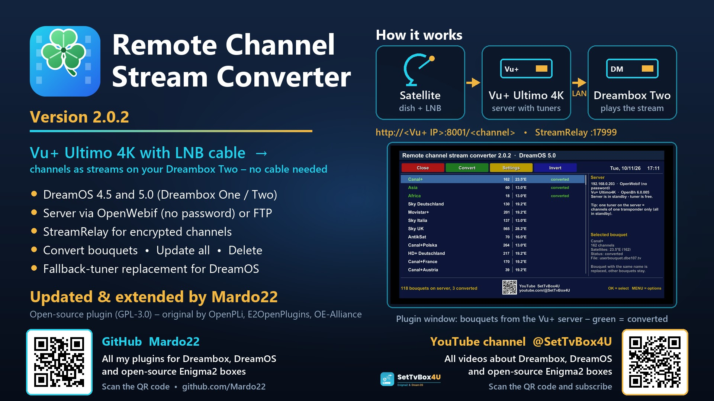

**Use the tuners of another Enigma2 receiver on your Dreambox** – an Enigma2 plugin for **DreamOS 4.5 and DreamOS 5.0**
(tested on Dreambox Two). It converts the bouquets of a second receiver (the *server*, e.g. a Vu+ with OpenATV / OpenBH /
OpenPLi) into stream bouquets on the Dreambox, so the Dreambox plays the channels through the tuners of the server –
with picons and EPG. The Vu+ needs the LNB cable – the Dreambox does not.

DreamOS has no "Fallback tuner" function like OpenPLi / OE-Alliance images – this plugin is the DreamOS way to do it.

**Current version: 2.0.2** (09.11.2026) – one package for DreamOS 4.5 and 5.0.

📺 YouTube channel: **[SetTvBox4U – youtube.com/@SetTvBox4U](https://www.youtube.com/@SetTvBox4U)**
🎬 Video guide "How to use": coming soon on the YouTube channel.
📄 PDF user guide: [English](docs/RCSC-2.0.2_User-Guide_EN.pdf) · [Arabic – العربية](docs/RCSC-2.0.2_User-Guide_AR.pdf) · [Slovak – Slovensky](docs/RCSC-2.0.2_Navod_SK.pdf)

## How it works

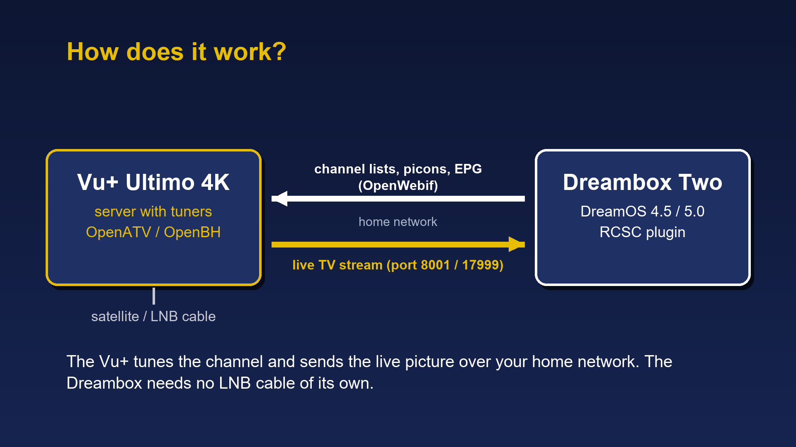

The Vu+ tunes the channel and sends the live picture over your home network. The Dreambox needs no LNB cable of its own.

## Screenshots

| Plugin window | Options (MENU) |
|---|---|
| 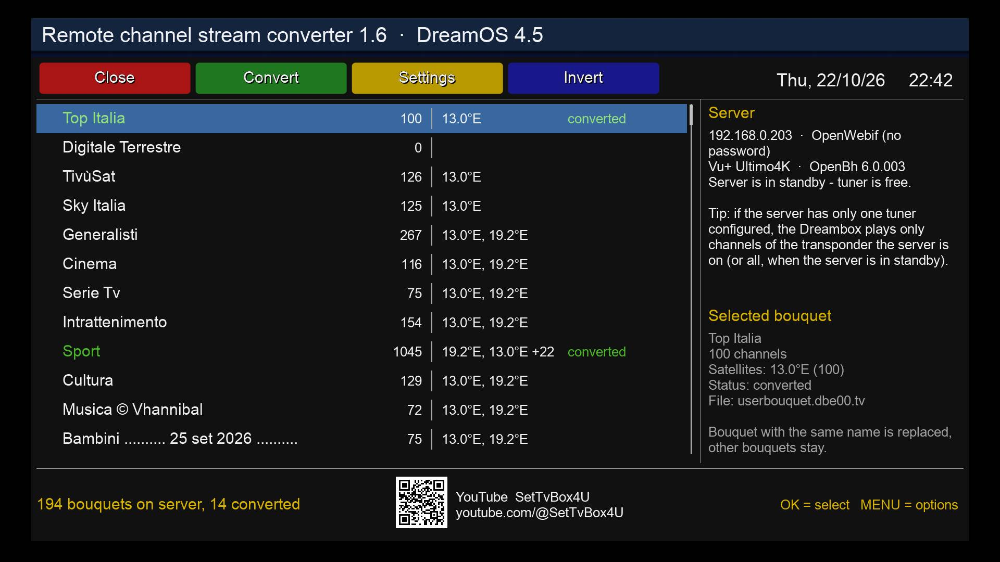 | 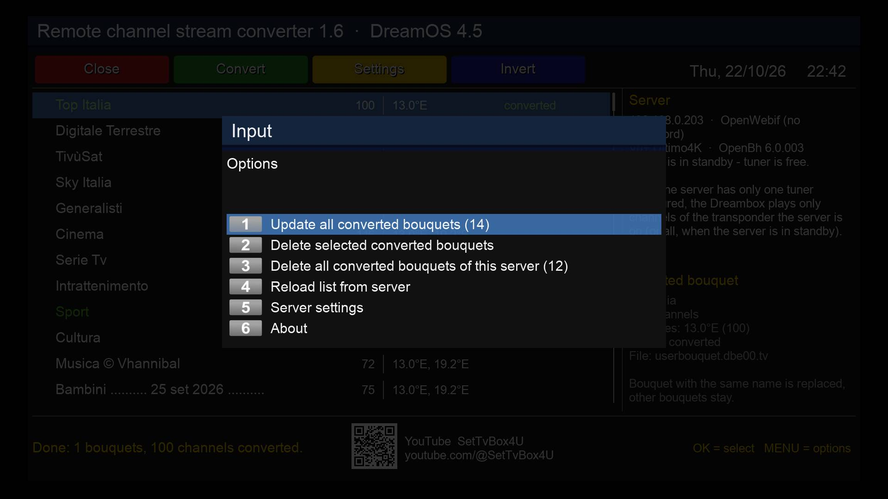 |
| **Select bouquets (OK)** | **Convert – result** |
|  | 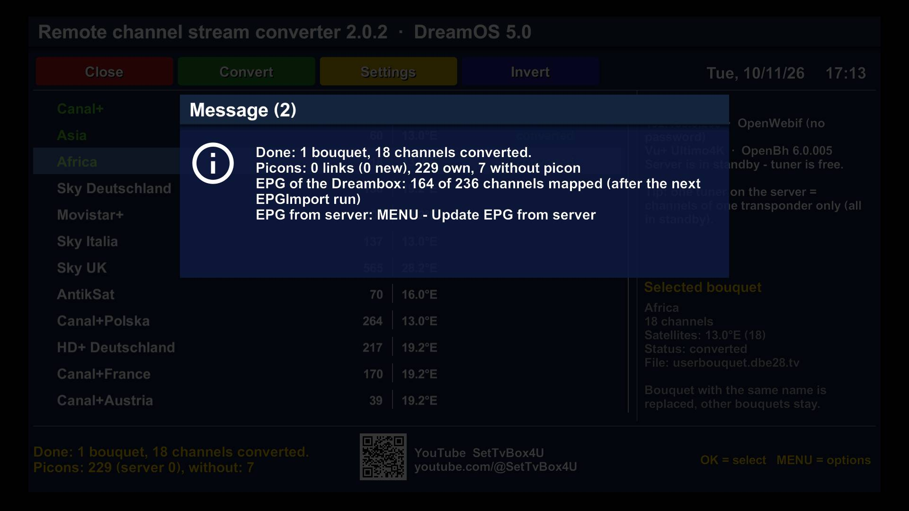 |
| **Bouquet list on the Dreambox** | **Channels with picons and EPG** |
| 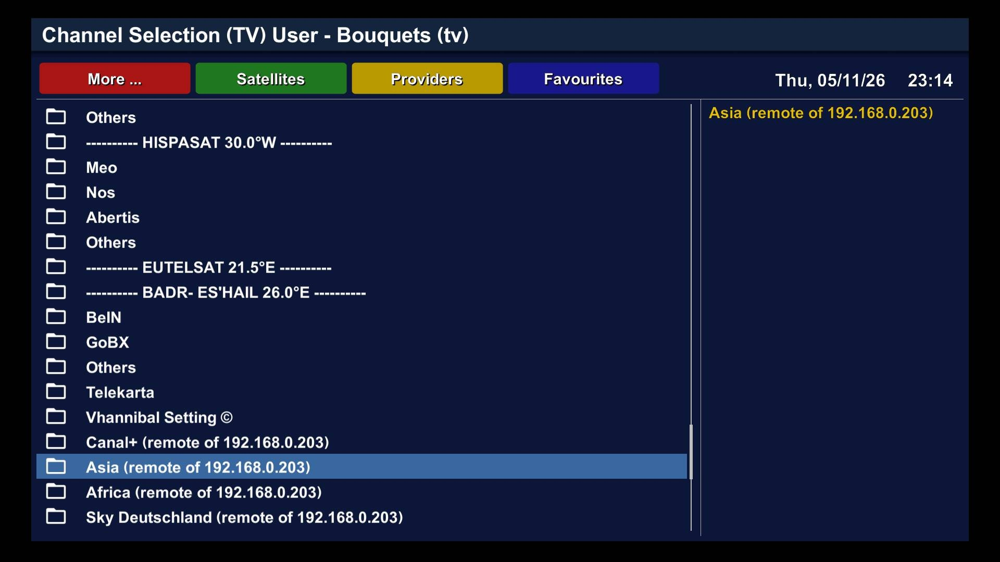 | 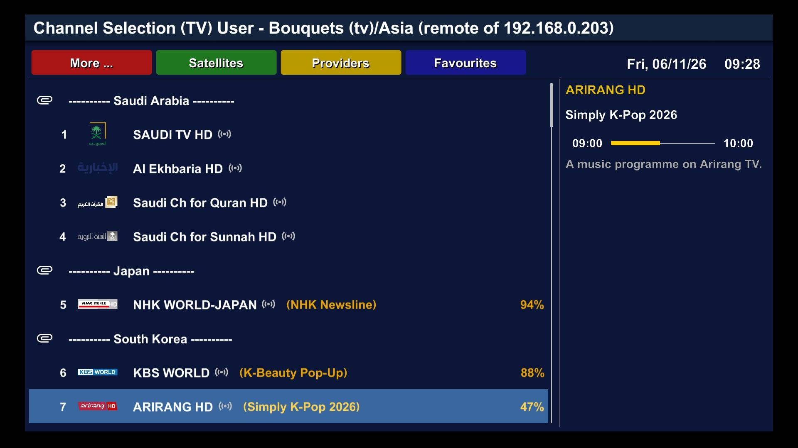 |
| **Settings** | **EPG from server** |
| 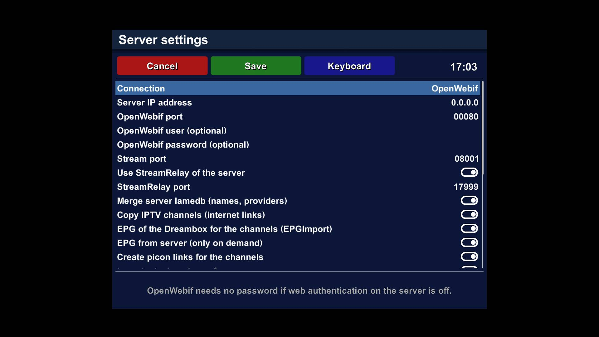 | 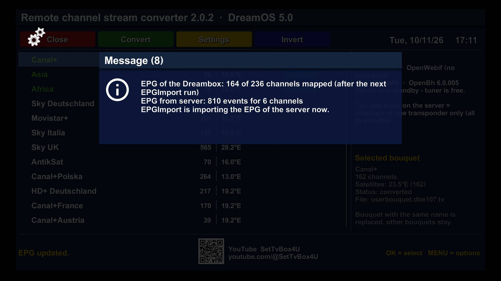 |

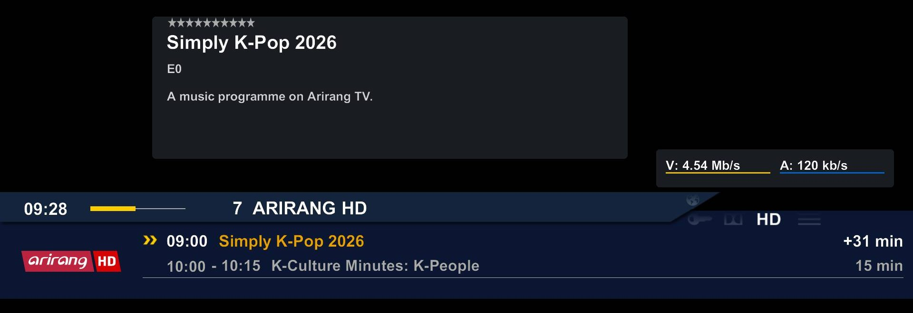

## Features
- One package for **DreamOS 4.5 and 5.0** – the system is detected automatically.
- Download from the server via **OpenWebif (no password)** or **FTP (with password)**.
- Full HD window: all bouquets of the server with number of channels and satellites, converted bouquets in green.
- Server status: model, image, standby / current channel, busy tuners.
- **Convert**, **update all converted** and **delete** converted bouquets; a bouquet with the same name is replaced,
  other bouquets stay.
- **Picons:** the stream channels use the picons already on the Dreambox (links are created where needed);
  missing picons can be taken from the server (option). Own picon files are never changed.
- **EPG without changing channel references or numbers:**
  - EPG of the Dreambox (EPGImport sources) is assigned to the stream channels automatically (option),
  - EPG of the server can be imported on demand (MENU "Update EPG from server").
- **IPTV channels** of the server are copied with their original internet links (option).
- **StreamRelay** (OE-Alliance images): channels in the server's `whitelist_streamrelay` are streamed on port 17999 –
  the server decrypts them (option).
- Server services merged into the local `lamedb` without duplicates (option), optional backup of `/etc/enigma2`.
- Optional entries in the plugin browser, extensions menu and main menu.
- Languages: English, Slovak, Czech.

## Requirements
- Dreambox with **DreamOS 4.5 or 5.0** (Python 2.7) – tested on **Dreambox Two**.
- Server: an Enigma2 receiver in the same network with **OpenWebif** (port 80) or FTP, streaming on port **8001**.
- For EPG: the EPGImport plugin on the Dreambox (optional).
- The Dreambox can only play what the server can tune: if the server has only one tuner configured, the Dreambox plays
  only channels of the transponder the server is on (or all channels while the server is in standby).

## Installation
1. Download `enigma2-plugins-remotechannelconverter-dreamos_2.0.2_all.deb` from [Releases](../../releases)
   (or from the `release/` folder).
2. Copy it to `/tmp` of the Dreambox (FTP, e.g. FileZilla: host = IP of the Dreambox, user `root`, port 21):

   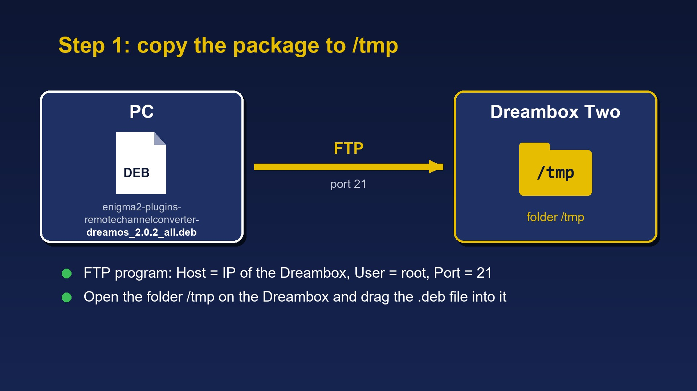
3. Install via telnet / SSH (e.g. PuTTY), log in as `root`:
   ```sh
   cd /tmp
   dpkg -i enigma2-plugins-remotechannelconverter-dreamos_2.0.2_all.deb
   systemctl restart enigma2
   ```
   or **MENU → Setup → Software management → Install local extension** → `/tmp` → **green**, then restart the GUI.

Update from an older version: install the new package the same way – converted bouquets and settings stay.

## Usage
**Full step-by-step guide with screenshots: [docs/GUIDE.md](docs/GUIDE.md)**

1. **MENU → Setup → Services and Recordings → Service Searching → Remote channel stream converter**
2. At the first start the **settings** open: enter the IP address of the server, green = save.
3. Select bouquets with **OK**, then **green (Convert)**.
4. **MENU** in the plugin: update all converted bouquets, delete converted bouquets, picon links, EPG from server,
   EPGImport, reload, settings, About.

The converted bouquets are named `… (remote of <server IP>)` and appear in the normal channel list.

## Build the package yourself
```sh
./build.sh          # on a Linux / Enigma2 box with dpkg-deb
```

## Credits
- Original plugin **"Remote channel stream converter"** for Enigma2 – OpenPLi, E2OpenPlugins
  ([e2openplugin-RemoteChannelStreamConverter](https://github.com/E2OpenPlugins/e2openplugin-RemoteChannelStreamConverter)),
  OE-Alliance ([RemoteChannelStreamConverter](https://github.com/oe-alliance-plugins/RemoteChannelStreamConverter), GPL-3.0).
- First DreamOS port 1.0 (2019) – **seagen** ([linuxsat-support.com](https://www.linuxsat-support.com/thread/139061-remote-stream-channel-converter/)) – the base of this update.
- Versions 1.1 – 2.0.2 for DreamOS 4.5 / 5.0 (new user interface, OpenWebif, IPTV, StreamRelay, picons, EPG, …):
  **Mardo22 ([SetTvBox4U](https://www.youtube.com/@SetTvBox4U))**, 2026 – see [CHANGELOG.md](CHANGELOG.md).

## License
**GNU General Public License v3.0** – see [LICENSE](LICENSE). You may use, share and modify this plugin; modified versions
must also be released under GPL-3.0 with their source code.

## Disclaimer
This plugin only converts the channel lists of your own receivers in your own network. It contains no channel lists,
no IPTV links and no keys. Use it only with services you are entitled to receive. No warranty.

---

### Slovensky (krátko)
Plugin pre **DreamOS 4.5 a 5.0** (verzia **2.0.2**), ktorý z buketov druhého prijímača (servera, napr. Vu+ s káblom z LNB)
vytvorí na Dreamboxe stream bukety – Dreambox potom používa tunery servera a kábel nepotrebuje (náhrada funkcie „Fallback“,
ktorá v DreamOS nie je), s piconmi a EPG.
**Celý návod po slovensky v PDF: [RCSC-2.0.2_Navod_SK.pdf](docs/RCSC-2.0.2_Navod_SK.pdf)**.
Inštalácia: súbor `.deb` do `/tmp`, cez telnet `dpkg -i …` alebo **MENU → Setup → Software management → Install local extension**.
Plugin: **MENU → Setup → Services and Recordings → Service Searching → Remote channel stream converter**.
YouTube: [SetTvBox4U](https://www.youtube.com/@SetTvBox4U). Licencia GPL-3.0.
