<div dir="rtl" align="right">

# بلجن Remote channel stream converter لنظام DreamOS

🌐 [English](README.md) · **العربية** · [Slovensky (PDF)](docs/RCSC-2.0.2_Navod_SK.pdf)

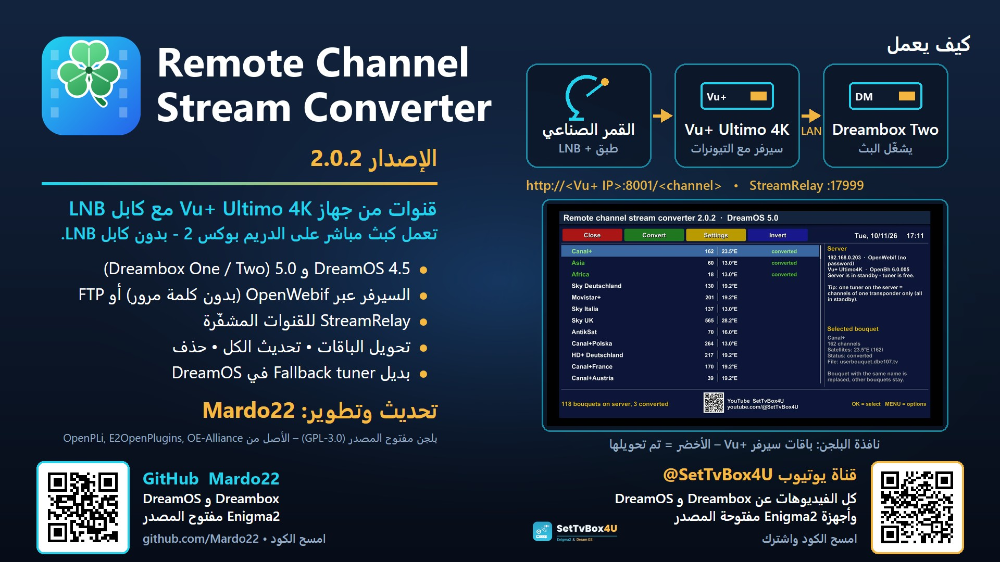

**استخدم تيونرات جهاز Enigma2 آخر على الدريم بوكس** – بلجن لنظام **DreamOS 4.5 و DreamOS 5.0** (تمت تجربته على Dreambox Two).

البلجن يحوّل باقات جهاز ثانٍ (نسمّيه **السيرفر**، مثلاً Vu+ مع OpenATV أو OpenBH أو OpenPLi) إلى باقات بث على الدريم بوكس.
عندما تشاهد إحدى هذه القنوات، يقوم السيرفر بضبط القناة ويرسل الصورة مباشرة عبر شبكة البيت – مع اللوغو (picons) ودليل البرامج (EPG).

قنوات من جهاز Vu+ Ultimo 4K مع كابل LNB تعمل كبث مباشر على الدريم بوكس 2 - بدون كابل LNB.

نظام DreamOS لا يحتوي على خاصية **Fallback tuner** الموجودة في OpenPLi و OE-Alliance – هذا البلجن هو الحل لنظام DreamOS.

**الإصدار الحالي: 2.0.2** (09.11.2026) – حزمة واحدة لنظام DreamOS 4.5 و 5.0.

📺 قناة يوتيوب: **[SetTvBox4U – youtube.com/@SetTvBox4U](https://www.youtube.com/@SetTvBox4U)**<br>
🎬 فيديو الشرح "طريقة الاستخدام": قريباً على قناة يوتيوب.<br>
📄 دليل الاستخدام PDF: [العربية](docs/RCSC-2.0.2_User-Guide_AR.pdf) · [English](docs/RCSC-2.0.2_User-Guide_EN.pdf) · [Slovensky](docs/RCSC-2.0.2_Navod_SK.pdf)


🆕 **صور مفتوحة المصدر (OpenATV و OpenBH و PurE2 – Python 3):** حزمة منفصلة 2.1.0 ← [open-source/](open-source/README_AR.md)

## كيف يعمل؟

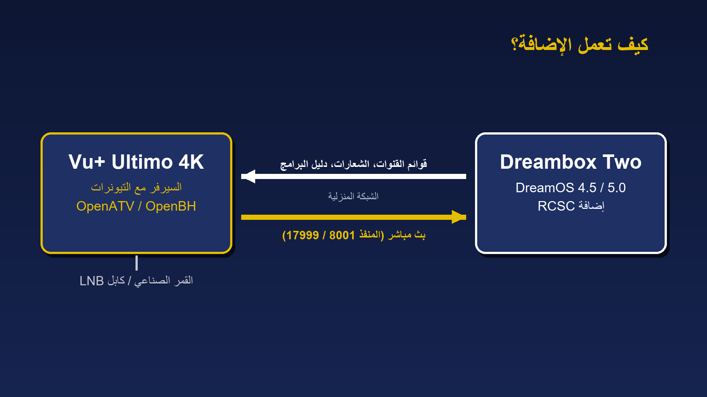

جهاز Vu+ يضبط القناة ويرسل الصورة المباشرة عبر شبكة البيت. الدريم بوكس لا يحتاج إلى كابل LNB خاص به.

## صور من البلجن

| نافذة البلجن | الخيارات (MENU) |
|---|---|
| 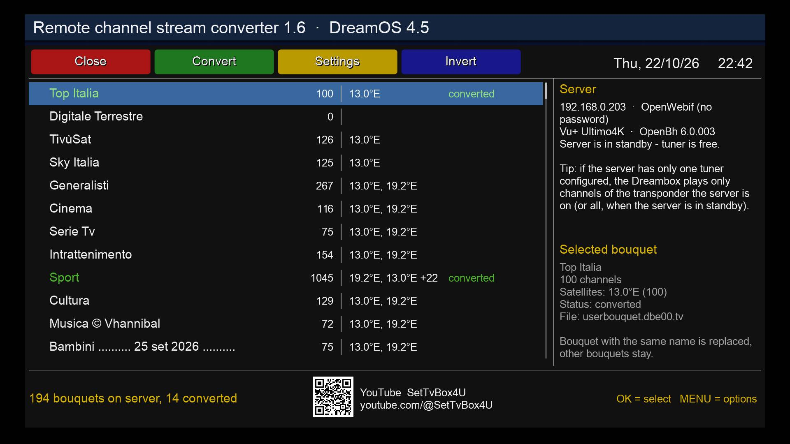 | 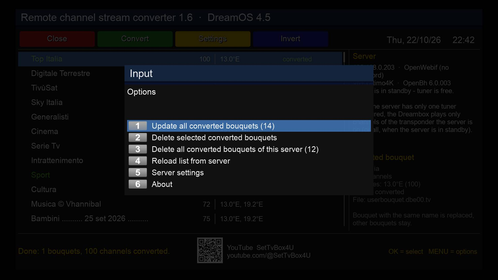 |
| **اختيار الباقات (OK)** | **التحويل – النتيجة** |
|  | 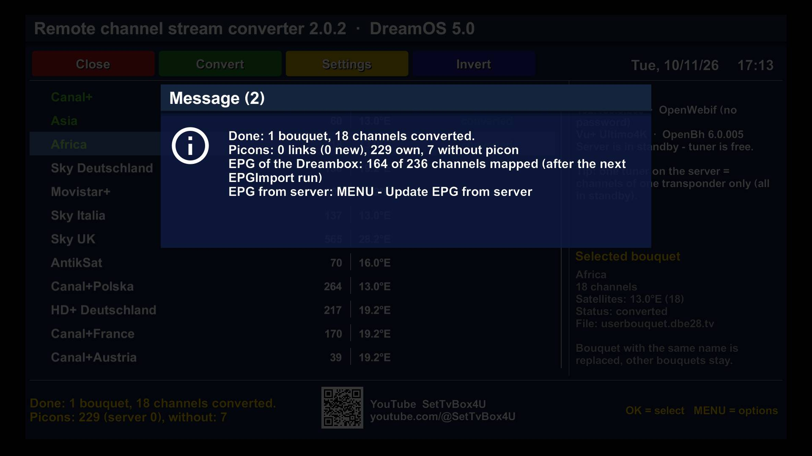 |
| **قائمة الباقات على الدريم بوكس** | **القنوات مع اللوغو ودليل البرامج** |
| 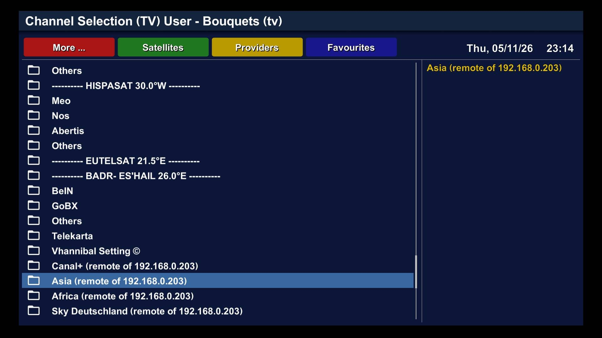 | 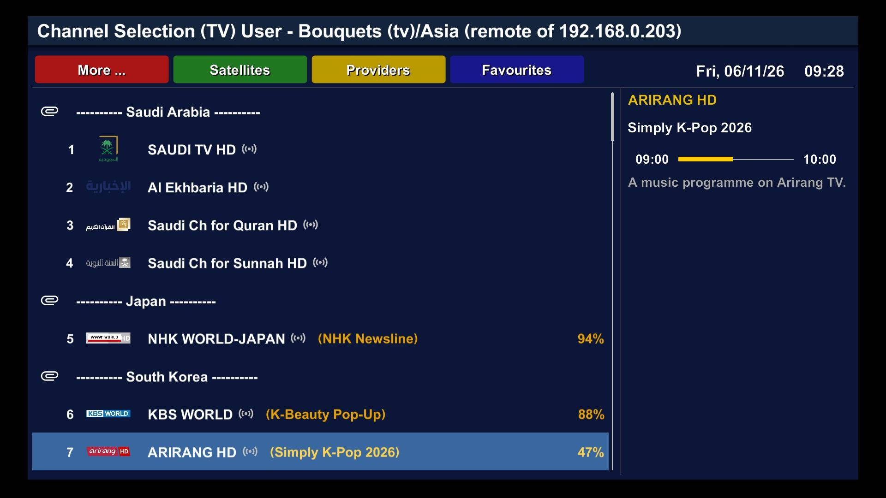 |
| **الإعدادات** | **دليل البرامج من السيرفر** |
| 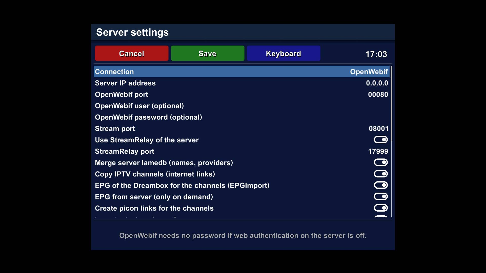 | 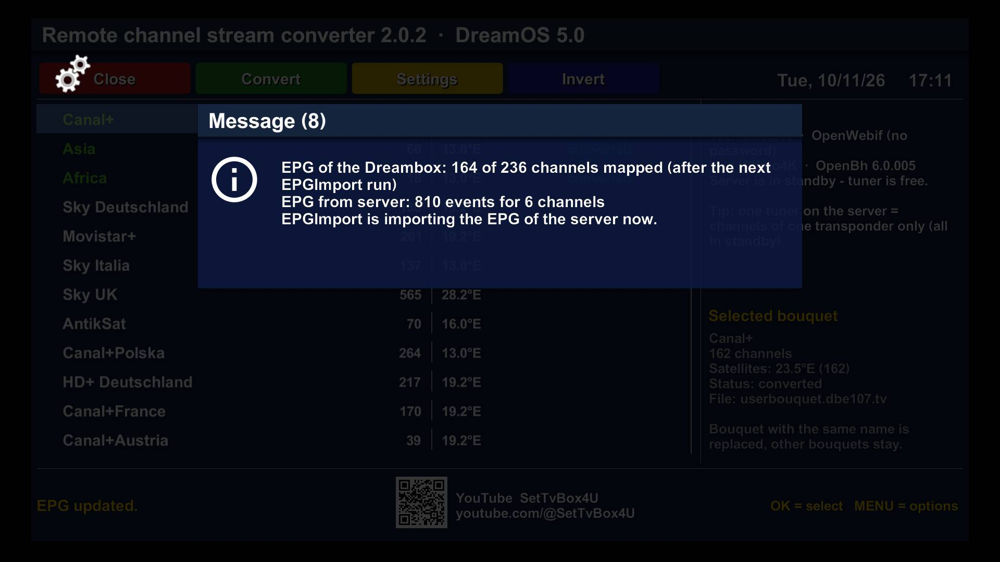 |

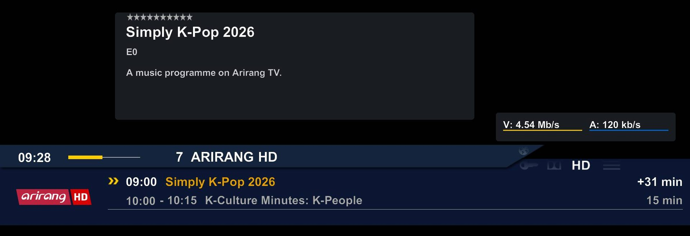

## المميزات
- حزمة واحدة لنظام **DreamOS 4.5 و 5.0** – يتعرّف البلجن على النظام تلقائياً.
- الاتصال بالسيرفر عبر **OpenWebif (بدون كلمة مرور)** أو **FTP (مع كلمة مرور)**.
- نافذة Full HD: كل باقات السيرفر مع عدد القنوات والأقمار، والباقات المحوّلة باللون الأخضر.
- حالة السيرفر: الموديل، الصورة (image)، وضع الاستعداد أو القناة الحالية، التيونرات المشغولة.
- **تحويل** الباقات، **تحديث كل** الباقات المحوّلة، و**حذف** الباقات المحوّلة. الباقة بنفس الاسم تُستبدل، والباقات الأخرى تبقى كما هي.
- **اللوغو (picons):** قنوات البث تستخدم اللوغو الموجود على الدريم بوكس، واللوغو الناقص يمكن أخذه من السيرفر (خيار). ملفات اللوغو الخاصة بك لا تتغيّر أبداً.
- **دليل البرامج (EPG) بدون تغيير أرقام القنوات:**
  - دليل البرامج من مصادر EPGImport على الدريم بوكس يُربط بالقنوات تلقائياً (خيار)،
  - دليل البرامج من السيرفر عند الطلب (MENU – Update EPG from server).
- **قنوات IPTV** الموجودة على السيرفر تُنسخ مع روابطها الأصلية (خيار).
- **StreamRelay** (صور OE-Alliance): القنوات الموجودة في `whitelist_streamrelay` على السيرفر تُبث على المنفذ 17999 – السيرفر يفك تشفيرها (خيار).
- دمج قنوات السيرفر في ملف `lamedb` بدون تكرار (خيار)، ونسخة احتياطية اختيارية لمجلد `/etc/enigma2`.
- إضافة البلجن إلى قائمة البلجنات، قائمة الإضافات أو القائمة الرئيسية (اختياري).
- لغات البلجن: الإنجليزية، السلوفاكية، التشيكية.

## المتطلبات
- دريم بوكس مع **DreamOS 4.5 أو 5.0** (Python 2.7) – تمت التجربة على **Dreambox Two**.
- السيرفر: جهاز Enigma2 في نفس الشبكة مع **OpenWebif** (المنفذ 80) أو FTP، والبث على المنفذ **8001**.
- لدليل البرامج: بلجن EPGImport على الدريم بوكس (اختياري).
- الدريم بوكس يشغّل فقط ما يستطيع السيرفر ضبطه: إذا كان في السيرفر تيونر واحد فقط، يشغّل الدريم بوكس قنوات الترددات التي عليها السيرفر فقط (أو كل القنوات عندما يكون السيرفر في وضع الاستعداد).

## التثبيت
1. حمّل الملف `enigma2-plugins-remotechannelconverter-dreamos_2.0.2_all.deb` من [Releases](../../releases) (أو من مجلد `release/`).
2. انسخه إلى المجلد `/tmp` في الدريم بوكس (برنامج FTP مثل FileZilla: العنوان = IP الدريم بوكس، المستخدم `root`، المنفذ 21):

   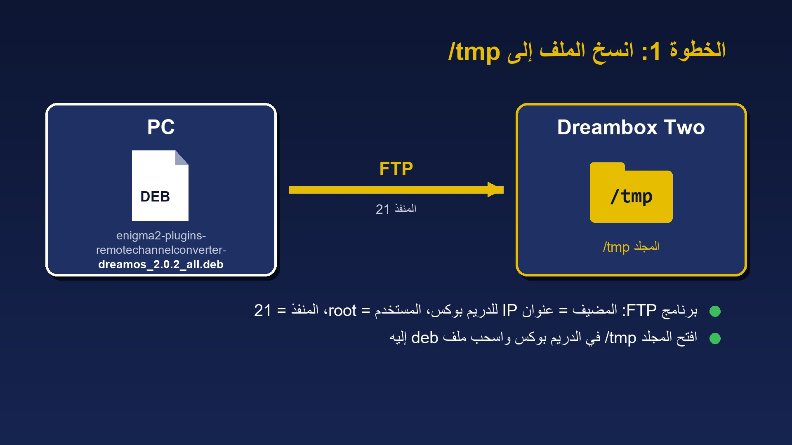
3. التثبيت عبر telnet أو SSH (مثلاً PuTTY)، الدخول باسم `root`:

   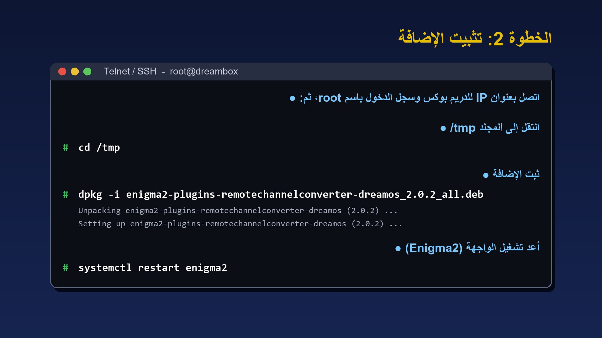

</div>

```sh
cd /tmp
dpkg -i enigma2-plugins-remotechannelconverter-dreamos_2.0.2_all.deb
systemctl restart enigma2
```

<div dir="rtl" align="right">

أو من القائمة: **MENU → Setup → Software management → Install local extension** → `/tmp` → **الزر الأخضر**، ثم أعد تشغيل الواجهة.

التحديث من إصدار قديم: ثبّت الحزمة الجديدة بنفس الطريقة – الباقات المحوّلة والإعدادات تبقى.

## طريقة الاستخدام
1. **MENU → Setup → Services and Recordings → Service Searching → Remote channel stream converter**
2. عند التشغيل الأول تُفتح **الإعدادات**: أدخل عنوان IP للسيرفر، الزر الأخضر = حفظ.
3. اختر الباقات بزر **OK**، ثم **الزر الأخضر (Convert)**. نصيحة: 3 باقات في كل مرة.
4. زر **MENU** داخل البلجن: تحديث كل الباقات المحوّلة، حذف الباقات المحوّلة، روابط اللوغو، دليل البرامج من السيرفر، EPGImport، إعادة التحميل، الإعدادات، About.

الباقات المحوّلة تحمل الاسم `… (remote of <IP السيرفر>)` وتظهر في قائمة القنوات العادية.

الشرح الكامل خطوة بخطوة مع الصور: [دليل الاستخدام PDF بالعربية](docs/RCSC-2.0.2_User-Guide_AR.pdf).

## الشكر
- البلجن الأصلي **Remote channel stream converter** لأجهزة Enigma2 – OpenPLi و E2OpenPlugins و OE-Alliance (رخصة GPL-3.0).
- نسخة DreamOS الأولى 1.0 (2019) – **seagen** ([linuxsat-support.com](https://www.linuxsat-support.com/thread/139061-remote-stream-channel-converter/)) – وهي أساس تحديثنا.
- الإصدارات 1.1 – 2.0.2 لنظام DreamOS 4.5 و 5.0 (واجهة جديدة، OpenWebif، IPTV، StreamRelay، اللوغو، دليل البرامج …):
  **Mardo22 ([SetTvBox4U](https://www.youtube.com/@SetTvBox4U))**، 2026 – انظر [CHANGELOG.md](CHANGELOG.md).

## الرخصة
**GNU General Public License v3.0** – انظر [LICENSE](LICENSE). يمكنك استخدام البلجن ومشاركته وتعديله؛ النسخ المعدّلة يجب نشرها أيضاً برخصة GPL-3.0 مع الكود المصدري.

## تنبيه
هذا البلجن يحوّل فقط قوائم القنوات من أجهزتك أنت في شبكتك أنت. لا يحتوي على قوائم قنوات ولا روابط IPTV ولا مفاتيح تشفير.
استخدمه فقط مع القنوات التي يحق لك مشاهدتها. بدون أي ضمان.

</div>
