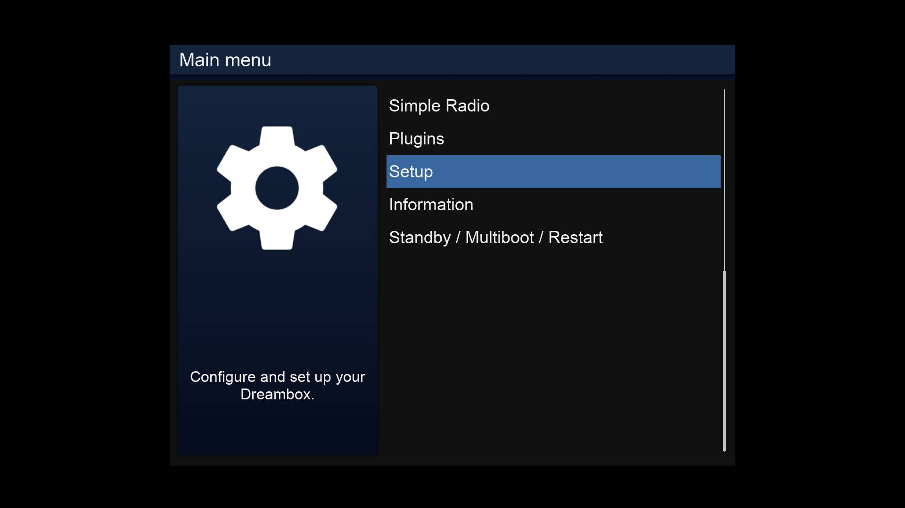
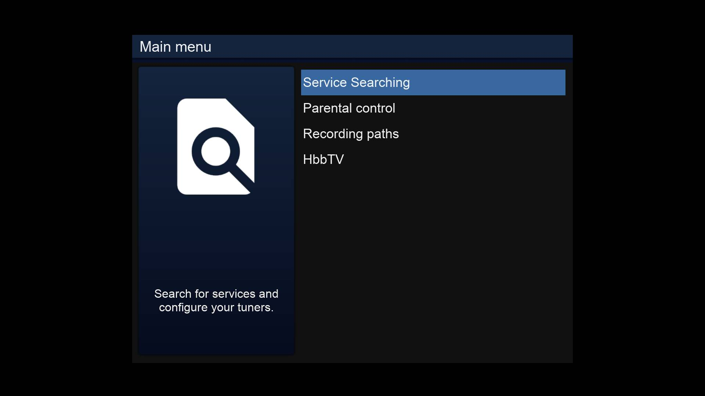
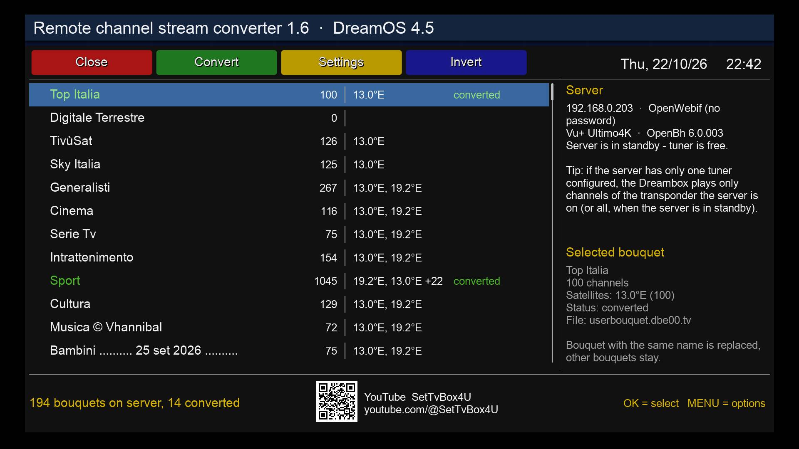
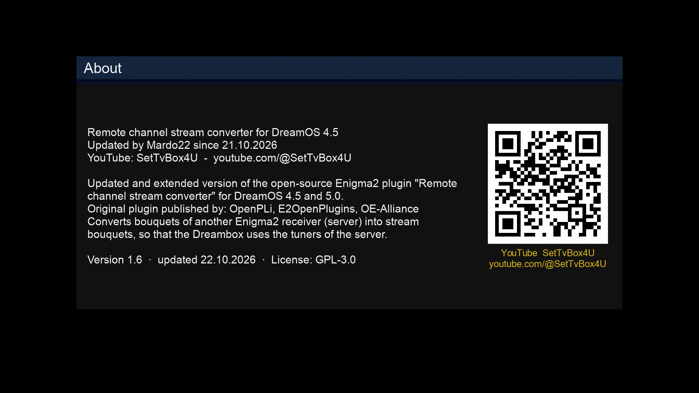

# Step-by-step guide – Remote channel stream converter for DreamOS

All screenshots were taken on a **Dreambox Two with DreamOS 4.5** (Default-FHD skin). The server in this example is a
**Vu+ Ultimo 4K with OpenBH** (IP `192.168.0.203`) – replace it with the IP address of your own server.

---

## 1. Open the plugin

**MENU → Setup**

**Setup → Services and Recordings**

**Services and Recordings → Service Searching**

**Service Searching → Remote channel stream converter** (next to Tuner configuration and Sat Finder – the same place as
"Tuners & Scanning" on OpenPLi / OE-Alliance images)

## 2. Main window

- **Title:** plugin version and the detected system (DreamOS 4.5 or 5.0).
- **Left:** all bouquets of the server – number of channels, satellites. Already converted bouquets are **green** with
  "converted".
- **Right:** server status (address, connection, model, image, standby / current channel, busy tuners) and details of the
  selected bouquet.
- **Bottom:** summary, QR code of the YouTube channel, key help.

| Key | Function |
|---|---|
| **OK** | select / unselect a bouquet |
| **Red** | close |
| **Green** | convert the selected bouquets |
| **Yellow** | settings |
| **Blue** | invert the selection |
| **MENU** | options (update, delete, reload, settings, About) |

## 3. Settings (yellow)

| Setting | Meaning |
|---|---|
| Connection | **OpenWebif** (no password, recommended) or **FTP** (root password of the server) |
| Server IP address | IP address of the receiver with the tuners |
| OpenWebif port / user / password | usually 80, user and password only if web authentication is on |
| Stream port | stream port of the server, usually **8001** |
| Use StreamRelay of the server | channels in the server's `whitelist_streamrelay` are decrypted by the server and streamed on the StreamRelay port |
| StreamRelay port | usually **17999** |
| Merge server lamedb | adds names and providers of the server's services to the local lamedb (without duplicates) |
| Copy IPTV channels | IPTV channels of the server are copied with their internet links |
| Backup /etc/enigma2 | backup to `/media/hdd/rcsc-backup` before converting (last 3 are kept) |
| Plugin language | auto / English / Slovenčina / Čeština |

Green = save, red = cancel, blue = keyboard for text fields.

## 4. Convert bouquets

Select one or more bouquets with **OK** (green tick):

Press **green (Convert)**:

The converted bouquet is named `<bouquet name> (remote of <server IP>)`. If a bouquet with the same name already exists,
it is replaced – other bouquets stay unchanged.

## 5. Options (MENU)

1. **Update all converted bouquets** – downloads all converted bouquets again (after the channel list of the server changed).
2. **Delete selected converted bouquets**
3. **Delete all converted bouquets of this server**
4. **Reload list from server**
5. **Server settings**
6. **About**

## 6. About

## 7. Watch

The converted bouquet appears in the normal channel list of the Dreambox, with picons and EPG:

The channel plays through the tuner of the server:

## Tips
- The Dreambox can only play what the server can tune. If the server has only **one** tuner configured, the Dreambox plays
  only channels of the transponder the server is on – or all channels while the server is in **standby**. Configure more
  tuners on the server (e.g. FBC tuners) to watch different channels on both receivers.
- After switching the boot slot or restarting the Dreambox, wait a few minutes before installing or restarting the GUI.
- If OpenWebif on the server asks for a password, enter user and password in the settings or use FTP.
