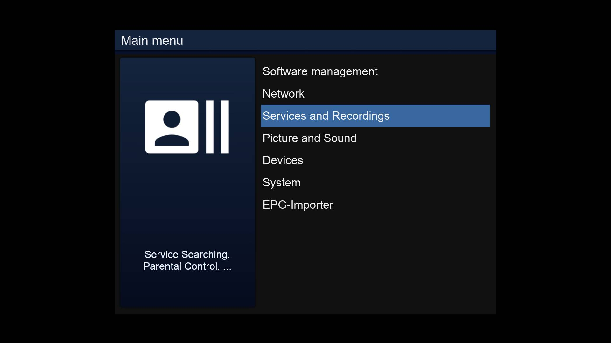
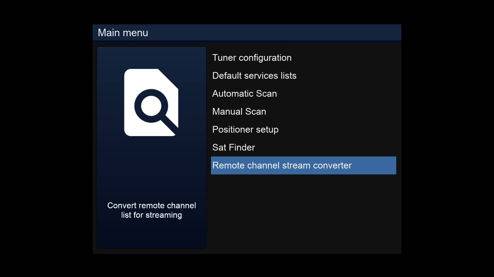
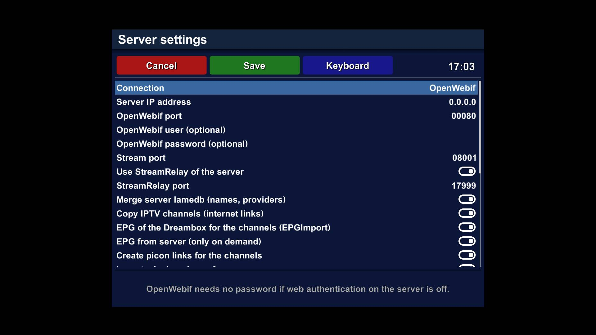
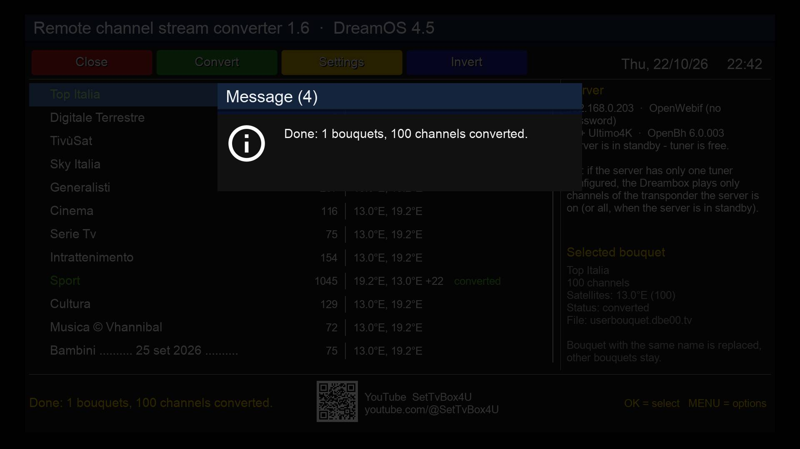
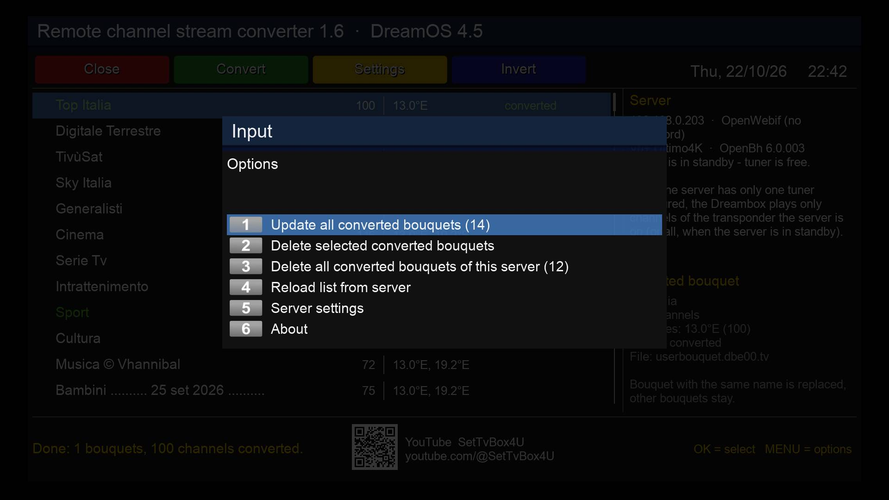
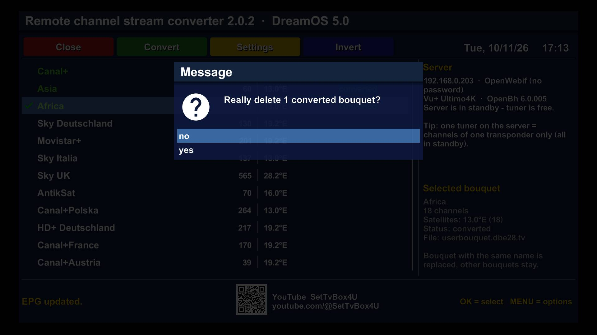
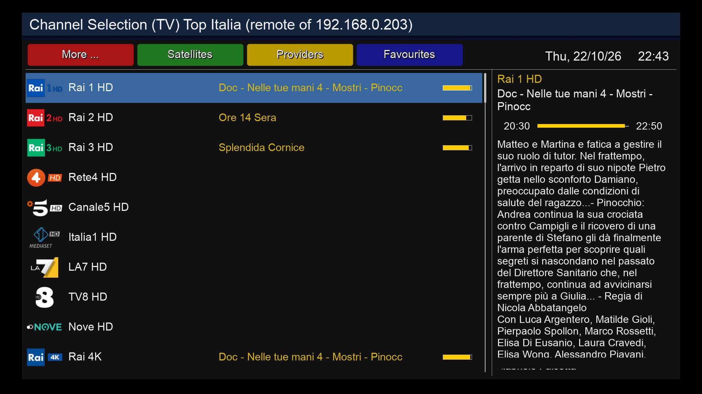
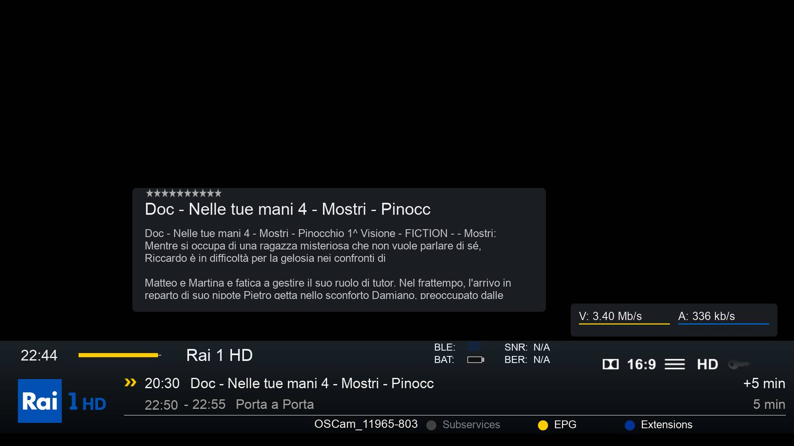

# Step-by-step guide – Remote channel stream converter 2.0.2 for DreamOS

> [!CAUTION]
> **⚠️ We do not support illegal viewing, sharing or distribution of TV channels. This plugin and all our videos are for educational purposes only.**<br>
> **⚠️ نحن لا ندعم المشاهدة أو المشاركة أو النشر غير القانوني للقنوات التلفزيونية. هذه الإضافة وجميع فيديوهاتنا لأغراض تعليمية فقط.**<br>
> **⚠️ Nepodporujeme nelegálne sledovanie, zdieľanie ani šírenie TV kanálov. Plugin aj všetky naše videá slúžia len na vzdelávacie účely.**<br>
> **⚠️ Wir unterstützen kein illegales Ansehen, Teilen oder Verbreiten von TV-Sendern. Dieses Plugin und alle unsere Videos dienen nur Lernzwecken.**<br>
> **⚠️ Ní thacaímid le féachaint, comhroinnt ná scaipeadh mídhleathach cainéal teilifíse. Is chun críocha oideachais amháin atá an breiseán seo agus ár bhfíseáin go léir.**

Screenshots: **Dreambox Two** with DreamOS 5.0 (version 2.0.2) and DreamOS 4.5 (menu screenshots of older versions –
the steps are the same). The server in this example is a **Vu+ Ultimo 4K with OpenBH** (IP `192.168.0.203`) – replace it
with the IP address of your own server.

📄 The same guide as PDF: [English](RCSC-2.0.2_User-Guide_EN.pdf) · [Arabic](RCSC-2.0.2_User-Guide_AR.pdf) · [Slovak](RCSC-2.0.2_Navod_SK.pdf)
📺 YouTube: [SetTvBox4U](https://www.youtube.com/@SetTvBox4U)

---

## 1. Install

1. Copy `enigma2-plugins-remotechannelconverter-dreamos_2.0.4_all.deb` to `/tmp` of the Dreambox
   (FTP program, e.g. FileZilla: host = IP of the Dreambox, user `root`, port 21).
2. Telnet / SSH to the Dreambox (e.g. PuTTY), log in as `root`:
   ```sh
   cd /tmp
   dpkg -i enigma2-plugins-remotechannelconverter-dreamos_2.0.4_all.deb
   systemctl restart enigma2
   ```
   or **MENU → Setup → Software management → Install local extension** → `/tmp` → green, then restart the GUI.

Update: install the new package the same way. Remove: `dpkg -r enigma2-plugins-remotechannelconverter-dreamos`.
Settings and converted bouquets stay.

## 2. Open the plugin

**MENU → Setup**


**Setup → Services and Recordings**



**Services and Recordings → Service Searching**


**Service Searching → Remote channel stream converter** (next to Tuner configuration and Sat Finder – the same place as
"Tuners & Scanning" on OpenPLi / OE-Alliance images). Entries in the plugin browser, extensions menu or main menu can be
switched on in the settings.



## 3. First start – settings

At the first start the plugin opens the **settings** by itself, because it needs the IP address of the server.
Enter the IP and press **green (Save)** – the plugin connects and shows the bouquets of the server.



| Setting | Meaning |
|---|---|
| Connection | **OpenWebif** (no password, recommended) or **FTP** (root password of the server) |
| Server IP address | IP address of the receiver with the tuners |
| OpenWebif port / user / password | usually 80; user and password only if web authentication is on |
| Stream port | stream port of the server, usually **8001** |
| Use StreamRelay of the server / StreamRelay port | channels in the server's `whitelist_streamrelay` are decrypted by the server (port **17999**) |
| Merge server lamedb | adds names and providers of the server's services to the local lamedb (without duplicates) |
| Copy IPTV channels | IPTV channels of the server are copied with their internet links |
| EPG of the Dreambox for the channels (EPGImport) | the EPG of your EPGImport sources is assigned to the stream channels |
| EPG from server (only on demand) | MENU "Update EPG from server" / "Update all" takes the EPG of the server for channels without EPG |
| Create picon links / Import missing picons from server / Picon directory | logos for the stream channels; own picons are never changed |
| Backup /etc/enigma2 before converting | backup to `/media/hdd/rcsc-backup` (last 3 are kept) |
| Show in plugin browser / extensions menu / main menu | extra entries (after a GUI restart) |
| Plugin language | auto / English / Slovenčina / Čeština |

Green = save, red = cancel, blue = keyboard for text fields.

## 4. Main window


- **Title:** plugin version and the detected system (DreamOS 4.5 or 5.0).
- **Left:** all bouquets of the server – number of channels, satellites. Converted bouquets are **green** with "converted".
- **Right:** server status (address, connection, model, image, standby / current channel, busy tuners), a short tip and
  details of the selected bouquet.
- **Bottom:** summary, QR code of the YouTube channel, key help.

| Key | Function |
|---|---|
| **OK** | select / unselect a bouquet |
| **Left / right** | one page up / down |
| **Red** | close |
| **Green** | convert the selected bouquets |
| **Yellow** | settings |
| **Blue** | invert the selection |
| **MENU** | options |

## 5. Convert bouquets

Select bouquets with **OK** (green tick) – tip: 3 bouquets at a time:


Press **green (Convert)**:




The converted bouquet is named `<bouquet name> (remote of <server IP>)`. A bouquet with the same name is replaced –
other bouquets stay unchanged.

## 6. Options (MENU)



1. **Update all converted bouquets** – downloads all converted bouquets again (and the EPG of the server).
2. **Delete selected converted bouquets** – asks first (no / yes).
3. **Delete all converted bouquets of this server**
4. **Update picon links of the channels**
5. **Update EPG from server** – imports the EPG of the server with EPGImport:

   
6. **Start EPGImport now (all sources)**
7. **Reload list from server**
8. **Server settings**
9. **About**



## 7. About


## 8. Watch

The converted bouquet appears in the normal channel list of the Dreambox, with picons and EPG:



The channel plays through the tuner of the server:



## Tips
- The Dreambox can only play what the server can tune. If the server has only **one** tuner configured, the Dreambox plays
  only channels of the transponder the server is on – or all channels while the server is in **standby**. Configure more
  tuners on the server (e.g. FBC tuners) to watch different channels on both receivers.
- Channels get EPG only if the Dreambox (EPGImport) or the server has EPG for them.
- After switching the boot slot or restarting the Dreambox, wait a few minutes before installing or restarting the GUI.
- If OpenWebif on the server asks for a password, enter user and password in the settings or use FTP.
